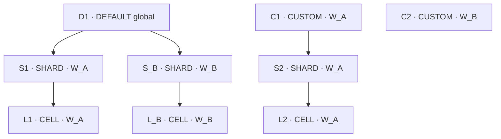

# Fluxo de dados e simulação dos endpoints de ambientes

Este documento simula os 29 endpoints de ambientes globais, ambientes de workspace, tipos e compatibilidades com os códigos DEFAULT, CUSTOM, SHARD e CELL. Os exemplos seguem os controllers, facades, schemas e use cases atuais. São cenários documentais: nenhuma chamada HTTP ou alteração de banco foi executada para produzir este arquivo.

As tabelas de consulta partem do estado-base abaixo. Sequências de alteração, inativação, restauração e exclusão são cenários independentes e indicam sua própria ordem de execução. Isso evita interpretar uma consulta como se ela ocorresse depois de uma exclusão de outra tabela.

## 1. Premissas e identificadores

O estado-base tem os quatro tipos ativos, as três compatibilidades iniciais ativas e dois workspaces já cadastrados e ativos. O cadastro dos workspaces pertence a outro fluxo. As simulações bem-sucedidas usam uma sessão OWNER com visibilidade dos registros; a coluna de permissão dos endpoints mostra a política exigida pela facade.

Nos exemplos, chamadas com body usam `Content-Type: application/json`. Autenticação e contexto de correlação são fornecidos pela requisição/sessão; não são atributos do body. UUIDs e datas abaixo são fictícios. Identificadores de ambientes e compatibilidades são gerados pelo servidor; o cliente guarda o identifier retornado e o reutiliza nas próximas chamadas.

| Apelido | Identifier ilustrativo | Uso |
| --- | --- | --- |
| W_A | `11111111-1111-4111-8111-111111111111` | Workspace Alfa |
| W_B | `22222222-2222-4222-8222-222222222222` | Workspace Beta |
| D1 | `aaaaaaaa-aaaa-4aaa-8aaa-aaaaaaaaaaa1` | Ambiente global DEFAULT |
| D2 | `aaaaaaaa-aaaa-4aaa-8aaa-aaaaaaaaaaa2` | DEFAULT temporário para simular lifecycle |
| C1 | `bbbbbbbb-bbbb-4bbb-8bbb-bbbbbbbbbbb1` | CUSTOM raiz do W_A |
| C2 | `bbbbbbbb-bbbb-4bbb-8bbb-bbbbbbbbbbb2` | CUSTOM raiz do W_B |
| C_TMP | `bbbbbbbb-bbbb-4bbb-8bbb-bbbbbbbbbbb3` | CUSTOM temporário para simular lifecycle |
| S1 | `cccccccc-cccc-4ccc-8ccc-ccccccccccc1` | SHARD do W_A sob D1 |
| S2 | `cccccccc-cccc-4ccc-8ccc-ccccccccccc2` | SHARD do W_A sob C1 |
| S_B | `cccccccc-cccc-4ccc-8ccc-ccccccccccc3` | SHARD do W_B sob D1 |
| L1 | `dddddddd-dddd-4ddd-8ddd-ddddddddddd1` | CELL do W_A sob S1 |
| L2 | `dddddddd-dddd-4ddd-8ddd-ddddddddddd2` | CELL do W_A sob S2 |
| L_B | `dddddddd-dddd-4ddd-8ddd-ddddddddddd3` | CELL do W_B sob S_B |
| K_DS | `eeeeeeee-eeee-4eee-8eee-eeeeeeeeeee1` | Compatibilidade DEFAULT → SHARD |
| K_CS | `eeeeeeee-eeee-4eee-8eee-eeeeeeeeeee2` | Compatibilidade CUSTOM → SHARD |
| K_SL | `eeeeeeee-eeee-4eee-8eee-eeeeeeeeeee3` | Compatibilidade SHARD → CELL |
| K_DC | `eeeeeeee-eeee-4eee-8eee-eeeeeeeeeee4` | Compatibilidade DEFAULT → CUSTOM criada em cenário separado |

Nas URLs das tabelas, `{W_A}`, `{D1}` e os demais apelidos devem ser substituídos pelo UUID correspondente. Nos bodies JSON, os UUIDs já estão escritos por extenso. Tipos são identificados diretamente por `code`, como `/environment-types/SHARD`; não possuem identifier UUID no contrato HTTP.

## 2. Estado-base dos tipos e das compatibilidades

### Tipos

| code | rootAllowed | workspaceRequired | allowsChildren inicial | lifecycle | displayOrder | Rota de cadastro de ambiente |
| --- | --- | --- | --- | --- | --- | --- |
| DEFAULT | true | false | true | ACTIVE | 1 | `/api/v1/environment-defaults` |
| CUSTOM | true | true | true | ACTIVE | 2 | `/api/v1/workspaces/{workspaceIdentifier}/environments` |
| SHARD | false | true | true | ACTIVE | 3 | `/api/v1/workspaces/{workspaceIdentifier}/environments` |
| CELL | false | true | false | ACTIVE | 4 | `/api/v1/workspaces/{workspaceIdentifier}/environments` |

As combinações de `rootAllowed` e `workspaceRequired` são regras fixas por código. `allowsChildren` é configurável, respeitando as proteções de uso. CELL está configurado como folha neste cenário; seu código, sozinho, não torna a flag imutável.

`rootAllowed=true` permite ausência de pai; não exige ausência de pai. Assim, CUSTOM pode ser raiz ou ter um pai compatível. A configuração não limita a quantidade de ambientes DEFAULT: D1 e D2 podem coexistir, com nomes diferentes no mesmo escopo.

### Compatibilidades iniciais

| identifier | parentTypeCode | childTypeCode | lifecycle | Exemplo de vínculo |
| --- | --- | --- | --- | --- |
| K_DS | DEFAULT | SHARD | ACTIVE | D1 → S1 |
| K_CS | CUSTOM | SHARD | ACTIVE | C1 → S2 |
| K_SL | SHARD | CELL | ACTIVE | S1 → L1 |

DEFAULT → CUSTOM, DEFAULT → CELL e CUSTOM → CELL não estão cadastradas inicialmente. Não são proibidas pelo nome dos códigos: precisam ser cadastradas como compatibilidades ativas e respeitar escopo, flags e ausência de ciclo.

## 3. Inventário dos 29 endpoints

`OPEN` é a política de leitura declarada na facade; não significa que este documento dispensa o contexto de autenticação da plataforma. Respostas `204` não têm body. Status de sucesso pressupõem as condições de elegibilidade do cenário.

| ID | Método | Endpoint | Permissão | Sucesso e resposta |
| --- | --- | --- | --- | --- |
| G01 | POST | `/api/v1/environment-defaults` | OWNER / CREATE | 201, ambiente |
| G02 | GET | `/api/v1/environment-defaults` | OPEN / READ | 200, lista de ambientes |
| G03 | GET | `/api/v1/environment-defaults/{identifier}` | OPEN / READ | 200, ambiente ativo |
| G04 | PUT | `/api/v1/environment-defaults/{identifier}` | OWNER / UPDATE | 200, ambiente atualizado |
| G05 | POST | `/api/v1/environment-defaults/{identifier}/inactivate` | OWNER / DEACTIVATE | 204 |
| G06 | POST | `/api/v1/environment-defaults/{identifier}/restore` | OWNER / RESTORE | 200, ambiente restaurado |
| G07 | DELETE | `/api/v1/environment-defaults/{identifier}` | OWNER / DELETE | 204, quarentena |
| W01 | POST | `/api/v1/workspaces/{workspaceIdentifier}/environments` | ADM / CREATE | 201, ambiente |
| W02 | GET | `/api/v1/workspaces/{workspaceIdentifier}/environments` | DEV / READ | 200, lista do workspace |
| W03 | GET | `/api/v1/workspaces/{workspaceIdentifier}/environments/{identifier}` | DEV / READ | 200, ambiente ativo do workspace |
| W04 | GET | `/api/v1/workspaces/{workspaceIdentifier}/environments/roots` | DEV / READ | 200, raízes globais e do workspace |
| W05 | GET | `/api/v1/workspaces/{workspaceIdentifier}/environments/{identifier}/children` | DEV / READ | 200, filhos do workspace sob o pai informado |
| W06 | GET | `/api/v1/workspaces/{workspaceIdentifier}/environments/tree` | DEV / READ | 200, árvore visível e ativa |
| W07 | PUT | `/api/v1/workspaces/{workspaceIdentifier}/environments/{identifier}` | ADM / UPDATE | 200, ambiente atualizado |
| W08 | POST | `/api/v1/workspaces/{workspaceIdentifier}/environments/{identifier}/inactivate` | ADM / DEACTIVATE | 204 |
| W09 | POST | `/api/v1/workspaces/{workspaceIdentifier}/environments/{identifier}/restore` | ADM / RESTORE | 200, ambiente restaurado |
| W10 | DELETE | `/api/v1/workspaces/{workspaceIdentifier}/environments/{identifier}` | ADM / DELETE | 204, quarentena |
| T01 | POST | `/api/v1/environment-types` | OWNER / CREATE | 201, tipo com código ainda ausente |
| T02 | GET | `/api/v1/environment-types` | OPEN / READ | 200, lista de tipos |
| T03 | GET | `/api/v1/environment-types/{code}` | OPEN / READ | 200, tipo |
| T04 | PUT | `/api/v1/environment-types/{code}` | OWNER / UPDATE | 200, tipo atualizado |
| T05 | POST | `/api/v1/environment-types/{code}/inactivate` | OWNER / DEACTIVATE | 204 |
| T06 | POST | `/api/v1/environment-types/{code}/restore` | OWNER / RESTORE | 200, tipo restaurado |
| T07 | DELETE | `/api/v1/environment-types/{code}` | OWNER / DELETE | 204, remoção física sem uso |
| K01 | POST | `/api/v1/environment-types/compatibilities` | OWNER / CREATE | 201, vínculo criado, mantido ativo ou reativado |
| K02 | GET | `/api/v1/environment-types/compatibilities` | OPEN / READ | 200, lista de compatibilidades |
| K03 | GET | `/api/v1/environment-types/compatibilities/{identifier}` | OPEN / READ | 200, compatibilidade |
| K04 | POST | `/api/v1/environment-types/compatibilities/{identifier}/inactivate` | OWNER / DEACTIVATE | 204 |
| K05 | DELETE | `/api/v1/environment-types/compatibilities/{identifier}` | OWNER / DELETE | 204, remoção física sem uso |

Não há endpoint `restore` de compatibilidade: a reativação ocorre pelo POST K01 com o mesmo par de códigos. Também não há endpoint HTTP de purge físico de ambientes.

## 4. Fluxo dos dados entre as camadas

| Etapa | Entrada | Trabalho realizado | Saída |
| --- | --- | --- | --- |
| Entrada HTTP | URL, body JSON e sessão | Biblioteca normaliza os campos conhecidos e valida o JSON Schema antes da desserialização | Request tipado |
| Controller | Request, identifiers/codes da URL e AuthorizationContext | Converte request em input e traduz o resultado para response/status HTTP | Chamada da facade |
| Facade | Input e contexto confiável de autorização | Exige a política declarada para a operação | Chamada do command ou query |
| Command de ambiente global | Input e identifier do ambiente | Delega às operações comuns com workspace interno nulo | EnvironmentOutput |
| Command de workspace | workspaceIdentifier, input e identifier do ambiente | Resolve workspace ativo e visível; na criação mantém lock do workspace até o fim da transação | ID interno e chamada das operações comuns |
| Operações e validators | Input normalizado e entidades/referências | Validam escopo, estado, versão, nome, pai, tipo e compatibilidade; coordenam locks | Entidade criada ou alterada |
| Repository | Entidade ou critérios de consulta | Persiste/flush ou consulta; constraints protegem unicidade e referências | Estado persistido ou dados de leitura |
| Auditoria do command | Output e contexto da sessão | Captura snapshot e evento na mesma transação | Registro de auditoria |
| Response HTTP | Output | Expõe UUIDs/códigos e campos públicos; não expõe entidades JPA ou IDs internos | JSON ou 204 sem body |

| Dado recebido | Destino ou regra |
| --- | --- |
| workspaceIdentifier na URL | Resolvido para `workspace_id`; não é campo aceito no body de ambiente |
| environmentTypeCode | Referência a `environment_types.code`; obrigatório em create e update |
| parentIdentifier | Resolvido para `parent_environment_id`; opcional no create e imutável após cadastro |
| name | Nome normalizado; único entre irmãos no mesmo workspace, incluindo registros inativos/quarentenados |
| description | Contrato de ambiente com 3 a 200 caracteres; tipo tem contrato próprio de 1 a 250 |
| authorizationType | DEV, TST ou ADM; não concede permissão ao autor da requisição |
| authorizerGroup | Opcional; normalizado com prefixo `E-` para ambientes e utilizado pela visibilidade |
| settings | Objeto JSON obrigatório; os exemplos usam `{}` ou um objeto válido |
| sortOrder | Inteiro positivo; empates permitidos, com desempate pelo ID interno |
| version | Não informar valor na criação; obrigatório no update e comparado após lock |
| identifier e lifecycle | Gerados/administrados pelo servidor; não são campos de entrada do cadastro |

Se `sortOrder` não for informado na criação, usa-se o maior valor dos irmãos + 1; sem irmãos, o início é 1 no escopo global e 4 no workspace, inclusive para um grupo de filhos. No update, omitir `sortOrder` conserva o valor atual. Os exemplos abaixo informam a ordem explicitamente.

## 5. Payloads e montagem do estado-base

### P_DEFAULT: ambiente global D1

POST `/api/v1/environment-defaults`:

```json
{
  "name": "Global desenvolvimento",
  "description": "Ambiente global compartilhado entre workspaces",
  "authorizationType": "DEV",
  "environmentTypeCode": "DEFAULT",
  "sortOrder": 1,
  "settings": {}
}
```

### P_CUSTOM: raiz C1 do W_A

POST `/api/v1/workspaces/11111111-1111-4111-8111-111111111111/environments`:

```json
{
  "name": "Custom Alfa",
  "description": "Raiz personalizada do workspace Alfa",
  "authorizationType": "DEV",
  "environmentTypeCode": "CUSTOM",
  "sortOrder": 4,
  "settings": {}
}
```

### P_SHARD: S1 sob D1, pertencendo ao W_A

POST na coleção de ambientes do W_A:

```json
{
  "name": "Shard global Alfa",
  "description": "Shard do workspace Alfa sob o ambiente global",
  "authorizationType": "DEV",
  "environmentTypeCode": "SHARD",
  "parentIdentifier": "aaaaaaaa-aaaa-4aaa-8aaa-aaaaaaaaaaa1",
  "sortOrder": 1,
  "settings": {"partition": "alfa"}
}
```

### P_CELL: L1 sob S1

POST na coleção de ambientes do W_A:

```json
{
  "name": "Cell global Alfa",
  "description": "Celula do workspace Alfa sob o shard global",
  "authorizationType": "DEV",
  "environmentTypeCode": "CELL",
  "parentIdentifier": "cccccccc-cccc-4ccc-8ccc-ccccccccccc1",
  "sortOrder": 1,
  "settings": {"node": "alfa-01"}
}
```

### Ordem de cadastro

As três compatibilidades iniciais já existem. Cada POST de ambiente retorna 201 com version inicial 0; o identifier retornado recebe o apelido da tabela.

| Passo | Endpoint | Payload ou ajuste | Registro resultante | workspace | Pai |
| --- | --- | --- | --- | --- | --- |
| 1 | G01 | P_DEFAULT | D1 / DEFAULT | global | nenhum |
| 2 | W01 em W_A | P_CUSTOM | C1 / CUSTOM | W_A | nenhum |
| 3 | W01 em W_A | P_SHARD | S1 / SHARD | W_A | D1 |
| 4 | W01 em W_A | P_CELL | L1 / CELL | W_A | S1 |
| 5 | W01 em W_A | P_SHARD com name `Shard custom Alfa` e parentIdentifier de C1 | S2 / SHARD | W_A | C1 |
| 6 | W01 em W_A | P_CELL com name `Cell custom Alfa` e parentIdentifier de S2 | L2 / CELL | W_A | S2 |
| 7 | W01 em W_B | P_CUSTOM com name `Custom Beta` e descrição de Beta | C2 / CUSTOM | W_B | nenhum |
| 8 | W01 em W_B | P_SHARD com name `Shard global Beta`, parentIdentifier de D1 e settings de Beta | S_B / SHARD | W_B | D1 |
| 9 | W01 em W_B | P_CELL com name `Cell global Beta`, parentIdentifier de S_B e settings de Beta | L_B / CELL | W_B | S_B |

### Dados persistidos no estado-base

| Ambiente | Tipo | workspace_id resolve para | parent_environment_id resolve para | lifecycle | version |
| --- | --- | --- | --- | --- | --- |
| D1 | DEFAULT | null | null | ACTIVE | 0 |
| C1 | CUSTOM | W_A | null | ACTIVE | 0 |
| S1 | SHARD | W_A | D1 | ACTIVE | 0 |
| L1 | CELL | W_A | S1 | ACTIVE | 0 |
| S2 | SHARD | W_A | C1 | ACTIVE | 0 |
| L2 | CELL | W_A | S2 | ACTIVE | 0 |
| C2 | CUSTOM | W_B | null | ACTIVE | 0 |
| S_B | SHARD | W_B | D1 | ACTIVE | 0 |
| L_B | CELL | W_B | S_B | ACTIVE | 0 |

D1 é um único registro global. S1 e S_B pertencem a workspaces diferentes, embora tenham o mesmo pai global. Nenhum registro de ambiente é copiado para o outro workspace.

### Exemplo de resposta de S1

Campos e valores ilustrativos de um POST W01 ou GET W03 bem-sucedido:

```json
{
  "version": 0,
  "identifier": "cccccccc-cccc-4ccc-8ccc-ccccccccccc1",
  "workspaceIdentifier": "11111111-1111-4111-8111-111111111111",
  "name": "Shard global Alfa",
  "description": "Shard do workspace Alfa sob o ambiente global",
  "authorizationType": "DEV",
  "environmentTypeCode": "SHARD",
  "parentIdentifier": "aaaaaaaa-aaaa-4aaa-8aaa-aaaaaaaaaaa1",
  "sortOrder": 1,
  "authorizerGroup": null,
  "settings": {"partition": "alfa"},
  "lifecycle": "ACTIVE",
  "createdAt": "2026-10-12T10:00:00",
  "updatedAt": "2026-10-12T10:00:00"
}
```

## 6. Simulação de consultas de ambientes

Conteúdos indicados pelas tabelas são conjuntos de registros; não representam uma nova regra de ordenação. As coleções usam sortOrder/ID. Tipos usam displayOrder/code e compatibilidades usam ID.

| ID | Chamada sobre o estado-base | HTTP | Conteúdo esperado |
| --- | --- | --- | --- |
| G02 | GET `/api/v1/environment-defaults` | 200 | `[D1]`; filtro padrão ACTIVE |
| G02 | GET `/api/v1/environment-defaults?lifecycle=INACTIVE` | 200 | `[]` |
| G02 | GET `/api/v1/environment-defaults?lifecycle=QUARANTINED` | 200 | `[]` |
| G03 | GET `/api/v1/environment-defaults/{D1}` | 200 | D1, workspaceIdentifier nulo |
| G03 | GET `/api/v1/environment-defaults/{C1}` | 404 | C1 não é global |
| W02 | GET `/api/v1/workspaces/{W_A}/environments` | 200 | C1, S1, L1, S2 e L2; D1 não faz parte da lista do workspace |
| W02 | GET `/api/v1/workspaces/{W_B}/environments` | 200 | C2, S_B e L_B |
| W02 | GET `/api/v1/workspaces/{W_A}/environments?lifecycle=INACTIVE` | 200 | `[]` |
| W02 | GET `/api/v1/workspaces/{W_A}/environments?lifecycle=QUARANTINED` | 200 | `[]` |
| W03 | GET `/api/v1/workspaces/{W_A}/environments/{S1}` | 200 | S1, incluindo parentIdentifier de D1 |
| W03 | GET `/api/v1/workspaces/{W_A}/environments/{D1}` | 404 | Detalhe global deve usar G03 |
| W03 | GET `/api/v1/workspaces/{W_B}/environments/{S1}` | 404 | S1 pertence ao W_A |
| W04 | GET `/api/v1/workspaces/{W_A}/environments/roots` | 200 | `[D1, C1]` |
| W04 | GET `/api/v1/workspaces/{W_B}/environments/roots` | 200 | `[D1, C2]` |
| W05 | GET `/api/v1/workspaces/{W_A}/environments/{D1}/children` | 200 | `[S1]`; S_B fica fora |
| W05 | GET `/api/v1/workspaces/{W_B}/environments/{D1}/children` | 200 | `[S_B]`; S1 fica fora |
| W05 | GET `/api/v1/workspaces/{W_A}/environments/{C1}/children` | 200 | `[S2]` |
| W05 | GET `/api/v1/workspaces/{W_A}/environments/{S1}/children` | 200 | `[L1]` |
| W05 | GET `/api/v1/workspaces/{W_A}/environments/{L1}/children` | 200 | `[]`; CELL é folha no cenário |
| W05 | GET `/api/v1/workspaces/{W_B}/environments/{C1}/children` | 404 | Pai pertence ao outro workspace |
| W06 | GET `/api/v1/workspaces/{W_A}/environments/tree` | 200 | Ramos D1 → S1 → L1 e C1 → S2 → L2 |
| W06 | GET `/api/v1/workspaces/{W_B}/environments/tree` | 200 | Ramos D1 → S_B → L_B e raiz C2 |

Roots, children e tree são consultas de hierarquia ativa e não expõem seleção de lifecycle. Cada nó da árvore tem formato `{"environment": <EnvironmentResponse>, "children": [...]}`; uma folha tem children vazio.



O desenho mostra o conjunto dos dois workspaces. Cada chamada de tree recebe apenas seus próprios ramos e as raízes globais visíveis.

## 7. Simulação de create, update e lifecycle de ambientes

### Ambiente global temporário D2: sequência G01 a G07

Para G01, usar P_DEFAULT com name `Global temporario`. Para G04, enviar o body completo abaixo, sem parentIdentifier:

```json
{
  "version": 0,
  "name": "Global temporario atualizado",
  "description": "Ambiente global temporario atualizado",
  "authorizationType": "TST",
  "environmentTypeCode": "DEFAULT",
  "sortOrder": 2,
  "settings": {"purpose": "simulation"}
}
```

| Passo | ID | Chamada | HTTP | Estado de D2 após a chamada | Dado retornado ou observado |
| --- | --- | --- | --- | --- | --- |
| 1 | G01 | POST `/api/v1/environment-defaults`, payload de criação de D2 | 201 | ACTIVE, version 0 | Identifier D2 e ambiente completo |
| 2 | G02 | GET `/api/v1/environment-defaults` | 200 | ACTIVE, version 0 | Lista inclui D1 e D2 |
| 3 | G03 | GET `/api/v1/environment-defaults/{D2}` | 200 | ACTIVE, version 0 | Body para edição |
| 4 | G04 | PUT `/api/v1/environment-defaults/{D2}`, payload acima | 200 | ACTIVE, version 1 | Campos alterados; createdAt preservado |
| 5 | G05 | POST `/api/v1/environment-defaults/{D2}/inactivate`, sem body | 204 | INACTIVE, version 2 | Sem body; G02 com INACTIVE inclui D2 |
| 6 | G03 | GET `/api/v1/environment-defaults/{D2}` | 404 | INACTIVE, version 2 | O detalhe de ambiente exige ACTIVE |
| 7 | G06 | POST `/api/v1/environment-defaults/{D2}/restore`, sem body | 200 | ACTIVE, version 3 | Ambiente completo e versão atual |
| 8 | G05 | POST `/api/v1/environment-defaults/{D2}/inactivate` | 204 | INACTIVE, version 4 | Preparação para exclusão |
| 9 | G07 | DELETE `/api/v1/environment-defaults/{D2}`, sem body | 204 | QUARANTINED, version 5 | Registro permanece no banco |
| 10 | G02 | GET `/api/v1/environment-defaults?lifecycle=QUARANTINED` | 200 | QUARANTINED, version 5 | Lista inclui D2 |
| 11 | G06 | POST `/api/v1/environment-defaults/{D2}/restore` | 400 | QUARANTINED, version 5 | Quarentena não pode ser restaurada por essa ação |
| 12 | G01 | POST com o mesmo nome final de D2 no escopo global | 400 | Sem novo registro | Nome continua reservado |

### Ambiente CUSTOM temporário C_TMP: sequência W01, W07 a W10

Criar com P_CUSTOM alterando name para `Custom temporario`. Seu pai permanece nulo. Atualizar com o body completo de P_CUSTOM, incluindo `version: 0`, name `Custom temporario atualizado` e os demais campos desejados; não enviar parentIdentifier.

| Passo | ID | Chamada | HTTP | Estado de C_TMP após a chamada | Observação |
| --- | --- | --- | --- | --- | --- |
| 1 | W01 | POST `/api/v1/workspaces/{W_A}/environments` | 201 | ACTIVE, version 0 | CUSTOM raiz, sem filhos |
| 2 | W07 | PUT `/api/v1/workspaces/{W_A}/environments/{C_TMP}` | 200 | ACTIVE, version 1 | Mesmo workspace, mesmo pai |
| 3 | W08 | POST `/api/v1/workspaces/{W_A}/environments/{C_TMP}/inactivate` | 204 | INACTIVE, version 2 | W02 com INACTIVE inclui C_TMP |
| 4 | W09 | POST `/api/v1/workspaces/{W_A}/environments/{C_TMP}/restore` | 200 | ACTIVE, version 3 | Retorna ambiente com a versão atual |
| 5 | W08 | POST `/api/v1/workspaces/{W_A}/environments/{C_TMP}/inactivate` | 204 | INACTIVE, version 4 | Preparação para exclusão |
| 6 | W10 | DELETE `/api/v1/workspaces/{W_A}/environments/{C_TMP}` | 204 | QUARANTINED, version 5 | Sem remoção física |
| 7 | W02 | GET `/api/v1/workspaces/{W_A}/environments?lifecycle=QUARANTINED` | 200 | QUARANTINED, version 5 | Lista inclui C_TMP |

### Efeito sobre descendentes e mudança de tipo

| Cenário independente | Chamada | Resultado esperado |
| --- | --- | --- |
| Inativar D1 no estado-base | G05 em D1 | 204; somente D1 muda para INACTIVE. S1, L1, S_B e L_B continuam ACTIVE no banco, mas saem da hierarquia ativa acessível |
| Consultar L1 enquanto D1 está inativo | W03 em L1 | 404 por ancestral inativo |
| Restaurar D1 | G06 em D1 | 200; descendentes ainda ACTIVE voltam a ser acessíveis sem atualização em cascata |
| Inativar C1 e tentar excluí-lo | W08 e W10 em C1 | Inativação 204; exclusão 409 porque S2 ainda referencia C1 |
| Inativar L2 e excluí-lo | W08 e W10 em L2 | 204 em ambas; L2 fica QUARANTINED |
| Excluir S2 depois de colocar L2 em quarentena | Inativar S2 e chamar W10 | 409: um filho QUARANTINED também impede a exclusão do pai |
| Alterar parentIdentifier em update | W07 em L1, com version atual e parentIdentifier de S2 | 400; pai é imutável, mesmo sendo um UUID válido |
| Trocar CUSTOM raiz por SHARD | W07 em C_TMP com environmentTypeCode SHARD | 400: SHARD exige pai |
| Trocar um SHARD sem filhos sob C1 por CELL | Cadastrar CUSTOM → CELL ativa; depois W07 com version atual e CELL | 200 se tipos e pai elegíveis; identifier e pai permanecem |
| Trocar S1 por CELL mantendo L1 como filho | Cadastrar DEFAULT → CELL ativa; depois W07 em S1 | 400: não se pode trocar o tipo de um ambiente com filhos |

Em todos os PUTs, o body é completo: name, description, authorizationType, settings, environmentTypeCode e version. Não é uma operação PATCH. Omitir authorizerGroup remove o grupo atual; omitir sortOrder preserva a ordem; parentIdentifier omitido ou nulo conserva o pai.

## 8. Simulação dos endpoints de tipos

### Payload de tipo e resposta

P_TYPE_CELL, usado em T01 quando CELL estiver ausente:

```json
{
  "code": "CELL",
  "name": "Cell",
  "description": "Celula de um workspace",
  "rootAllowed": false,
  "allowsChildren": false,
  "workspaceRequired": true,
  "displayOrder": 4
}
```

Para T04, o body possui esses mesmos campos e acrescenta `version` retornada na última consulta. As flags de escopo precisam continuar corretas para o code da URL.

| ID | Cenário ou chamada | HTTP | Resultado e efeito |
| --- | --- | --- | --- |
| T01 | POST `/api/v1/environment-types`, P_TYPE_CELL no estado-base | 400 | CELL já existe; não cria uma segunda linha |
| T01 | Mesmo POST após purge elegível de CELL em cenário sem uso | 201 | Tipo ACTIVE com version 0; resposta contém code, flags, displayOrder e lifecycle |
| T02 | GET `/api/v1/environment-types` no estado-base | 200 | DEFAULT, CUSTOM, SHARD e CELL, ordenados por displayOrder/code |
| T02 | GET `/api/v1/environment-types?lifecycle=INACTIVE` no estado-base | 200 | `[]` |
| T02 | GET `/api/v1/environment-types?lifecycle=QUARANTINED` no estado-base | 200 | `[]`; o fluxo de tipos não faz quarentena |
| T03 | GET `/api/v1/environment-types/SHARD` | 200 | Tipo SHARD, incluindo version atual |
| T04 | PUT `/api/v1/environment-types/SHARD`, version atual, allowsChildren true e novo name | 200 | SHARD atualizado; versão incrementada |
| T04 | PUT `/api/v1/environment-types/CELL`, version atual, allowsChildren false e novo name | 200 | K_SL como vínculo de entrada não impede CELL de continuar folha |
| T04 | PUT `/api/v1/environment-types/SHARD` com allowsChildren false no estado-base | 400 | K_SL está ACTIVE e SHARD possui ambientes filhos; flag não muda |
| T05 | POST `/api/v1/environment-types/SHARD/inactivate` | 204 | SHARD fica INACTIVE; ambientes existentes permanecem |
| T03 | GET `/api/v1/environment-types/SHARD` depois da inativação | 200 | Detalhe de tipo também permite lifecycle INACTIVE |
| T06 | POST `/api/v1/environment-types/SHARD/restore` depois da inativação | 200 | SHARD volta a ACTIVE, com versão atualizada |
| T07 | DELETE `/api/v1/environment-types/CELL` enquanto ACTIVE | 400 | Exige INACTIVE |
| T07 | Inativar CELL e tentar DELETE no estado-base | 400 | K_SL e ambientes CELL continuam referenciando o tipo |
| T07 | DELETE de tipo INACTIVE sem ambientes nem compatibilidades de qualquer estado | 204 | Remoção física; auditoria PURGE; consulta posterior retorna 404 |

Uma resposta de tipo expõe `version`, `code`, `name`, `description`, `rootAllowed`, `allowsChildren`, `workspaceRequired`, `displayOrder` e `lifecycle`. Não expõe identifier ou ID numérico.

### Inativação do tipo SHARD com ambientes existentes

| Operação após T05 em SHARD | HTTP esperado | Motivo |
| --- | --- | --- |
| GET de S1 ou L1 pelas rotas corretas | 200 | Lifecycle dos ambientes e ancestrais continua ACTIVE |
| PUT de S1 mantendo environmentTypeCode SHARD e version atual | 200 | Manutenção de vínculo existente admite tipo inativo |
| Inativar e restaurar S1, mantendo ancestrais ativos | 204 e 200 | Restauração admite tipo inativo no vínculo existente |
| POST de novo SHARD sob D1 | 404 | Tipo escolhido precisa estar ativo para novo vínculo |
| POST de nova CELL sob S1 | 404 | O tipo do pai SHARD também precisa estar ativo para novo vínculo |
| POST K01 de novo par com SHARD | 400 | Criação/reativação de compatibilidade exige ambos os tipos ativos |

### Bloqueio de allowsChildren=false: cenário isolado sem ambientes

Partir dos quatro tipos ativos e de K_SL ativo, mas sem ambientes cadastrados. Usar o body completo do tipo SHARD, com rootAllowed false, workspaceRequired true e displayOrder 3.

| Passo | Chamada | HTTP | Estado resultante |
| --- | --- | --- | --- |
| 1 | T04 em SHARD com version 0 e allowsChildren false | 400 | K_SL ativo impede a mudança; version permanece 0 |
| 2 | K04 em K_SL | 204 | K_SL fica INACTIVE |
| 3 | T04 em SHARD com version 0 e allowsChildren false | 200 | SHARD passa a allowsChildren false, version 1 |
| 4 | K01 com SHARD → CELL | 400 | Reativação rejeitada porque o pai não permite filhos |
| 5 | T04 em SHARD com version 1 e allowsChildren true | 200 | SHARD passa a allowsChildren true, version 2 |
| 6 | K01 com SHARD → CELL | 201 | K_SL volta a ACTIVE, conservando identifier |

Se houver ambientes filhos, inativar K_SL não basta para desabilitar allowsChildren. A proteção dos registros filhos é independente da atividade da compatibilidade.

## 9. Simulação dos endpoints de compatibilidades

### Criar, consultar, inativar, reativar e remover um vínculo sem uso

Partir do estado-base. Nenhum CUSTOM é filho de D1; C1 e C2 são raízes. P_COMPAT_DC:

```json
{
  "parentTypeCode": "DEFAULT",
  "childTypeCode": "CUSTOM"
}
```

| Passo | ID | Chamada | HTTP | Resultado |
| --- | --- | --- | --- | --- |
| 1 | K01 | POST `/api/v1/environment-types/compatibilities`, P_COMPAT_DC | 201 | Cria K_DC com lifecycle ACTIVE |
| 2 | K02 | GET `/api/v1/environment-types/compatibilities` | 200 | K_DS, K_CS, K_SL e K_DC |
| 3 | K03 | GET `/api/v1/environment-types/compatibilities/{K_DC}` | 200 | identifier K_DC, parentTypeCode DEFAULT, childTypeCode CUSTOM, lifecycle ACTIVE |
| 4 | K01 | Repetir o POST com P_COMPAT_DC | 201 | Mesmo identifier e mesma linha; não duplica o par |
| 5 | K04 | POST `/api/v1/environment-types/compatibilities/{K_DC}/inactivate` | 204 | K_DC passa a INACTIVE |
| 6 | K02 | GET `/api/v1/environment-types/compatibilities?lifecycle=INACTIVE` | 200 | Inclui K_DC |
| 7 | K03 | GET `/api/v1/environment-types/compatibilities/{K_DC}` | 200 | Detalhe mostra INACTIVE |
| 8 | K01 | POST com P_COMPAT_DC | 201 | Reativa K_DC, preservando identifier |
| 9 | K04 | Inativar K_DC novamente | 204 | K_DC volta a INACTIVE |
| 10 | K05 | DELETE `/api/v1/environment-types/compatibilities/{K_DC}` | 204 | Remove fisicamente porque não há ambiente usando DEFAULT → CUSTOM; auditoria PURGE |
| 11 | K03 | Consultar K_DC após o DELETE | 404 | Vínculo removido |
| 12 | K02 | GET `/api/v1/environment-types/compatibilities?lifecycle=QUARANTINED` | 200 | `[]`; compatibilidades não entram em quarentena neste fluxo |

O POST do passo 1 também permite, em um cenário próprio, cadastrar um CUSTOM do W_A sob D1: usar o payload de CUSTOM com parentIdentifier de D1. A mesma tentativa antes de cadastrar a compatibilidade retorna 400.

### Vínculo em uso: K_SL

| Passo ou cenário | Chamada | HTTP | Efeito |
| --- | --- | --- | --- |
| Inativar K_SL | K04 | 204 | Relações S1 → L1 e S2 → L2 permanecem no banco |
| Listar ou consultar L1 ativo | W02 ou W03 | 200 | Vínculo existente continua acessível |
| Atualizar L1 mantendo CELL | W07 com version atual | 200 | Não exige reativar K_SL |
| Inativar e restaurar L1 | W08 e W09 | 204 e 200 | Vínculo existente é preservado |
| Criar nova CELL sob S1 com K_SL inativo | W01 | 400 | Novo vínculo exige compatibilidade ACTIVE |
| Excluir K_SL inativo | K05 | 400 | Existem ambientes usando o par, em qualquer lifecycle |
| Reativar K_SL, mantendo tipos elegíveis | K01 com SHARD → CELL | 201 | Mesmo identifier K_SL |

### Matriz dos 16 pares: POST K01

Cada tentativa abaixo parte separadamente do estado-base. O status 201 pode representar criação ou manutenção de um par já ativo. As tentativas não são acumuladas para montar um novo grafo.

| Pai | Filho | HTTP | Motivo |
| --- | --- | --- | --- |
| DEFAULT | DEFAULT | 400 | Autorrelação |
| DEFAULT | CUSTOM | 201 | Novo par possível; CUSTOM aceita pai e requer workspace |
| DEFAULT | SHARD | 201 | Par já ativo K_DS; retorna o mesmo vínculo |
| DEFAULT | CELL | 201 | Novo par possível; permite CELL diretamente sob DEFAULT quando cadastrado |
| CUSTOM | DEFAULT | 400 | Pai de workspace não pode ter filho global |
| CUSTOM | CUSTOM | 400 | Autorrelação |
| CUSTOM | SHARD | 201 | Par já ativo K_CS |
| CUSTOM | CELL | 201 | Novo par possível; permite CELL diretamente sob CUSTOM quando cadastrado |
| SHARD | DEFAULT | 400 | Pai de workspace não pode ter filho global |
| SHARD | CUSTOM | 400 | Formaria ciclo com CUSTOM → SHARD |
| SHARD | SHARD | 400 | Autorrelação |
| SHARD | CELL | 201 | Par já ativo K_SL |
| CELL | DEFAULT | 400 | CELL não permite filhos neste cenário; escopo também inválido |
| CELL | CUSTOM | 400 | CELL não permite filhos neste cenário |
| CELL | SHARD | 400 | CELL não permite filhos neste cenário |
| CELL | CELL | 400 | CELL não permite filhos; elegibilidade é verificada antes do ciclo |

A restrição de ciclos se aplica também à reativação: um par inativo não pode voltar a ACTIVE se o grafo atual tornar sua ativação cíclica.

## 10. Simulação de purge e recriação de tipo sem uso

Este cenário é separado do estado-base de ambientes: possui os quatro tipos e as três compatibilidades iniciais, mas nenhum ambiente. CELL só é referenciado por K_SL. Os passos usam exclusivamente endpoints de tipo e compatibilidade.

| Passo | Endpoint | HTTP | Estado após a chamada |
| --- | --- | --- | --- |
| 1 | T05: POST `/api/v1/environment-types/CELL/inactivate` | 204 | CELL INACTIVE |
| 2 | T07: DELETE `/api/v1/environment-types/CELL` | 400 | K_SL ainda referencia CELL |
| 3 | K04: POST `/api/v1/environment-types/compatibilities/{K_SL}/inactivate` | 204 | K_SL INACTIVE |
| 4 | K05: DELETE `/api/v1/environment-types/compatibilities/{K_SL}` | 204 | K_SL removido, pois não há ambientes usando o par |
| 5 | T07: DELETE `/api/v1/environment-types/CELL` | 204 | CELL removido fisicamente; snapshot enviado à auditoria |
| 6 | T03: GET `/api/v1/environment-types/CELL` | 404 | Código ausente |
| 7 | T01: POST `/api/v1/environment-types`, P_TYPE_CELL | 201 | CELL recriado ACTIVE, version 0 |
| 8 | K01: POST com SHARD → CELL | 201 | Novo vínculo com novo identifier; o anterior foi removido |

Colocar ambientes em quarentena não transforma o estado-base em um cenário sem uso. Os registros permanecem referenciando tipos e pais; portanto, continuam impedindo purges e a exclusão de seus pais. Esta API não oferece remoção física desses ambientes.

## 11. Matriz de criação de ambiente por tipo e escopo

As linhas abaixo pressupõem body estruturalmente válido. O escopo deriva da rota; nunca é inferido de um workspace enviado no body.

| Rota | environmentTypeCode | Pai | HTTP esperado | Regra |
| --- | --- | --- | --- | --- |
| Global | DEFAULT | ausente | 201 | Tipo global permite raiz |
| Global | CUSTOM, SHARD ou CELL | qualquer | 404 | Tipo selecionado não corresponde ao escopo global |
| Workspace | DEFAULT | qualquer | 404 | DEFAULT não exige workspace |
| Workspace | CUSTOM | ausente | 201 | CUSTOM permite raiz de workspace |
| Workspace | SHARD | ausente | 400 | SHARD não permite raiz |
| Workspace | CELL | ausente | 400 | CELL não permite raiz |
| W_A | SHARD | D1 | 201 | Pai global ativo e K_DS ativo |
| W_A | SHARD | C1 | 201 | Mesmo workspace e K_CS ativo |
| W_A | CELL | S1 | 201 | Mesmo workspace e K_SL ativo |
| W_A | CELL | D1 | 400 no estado-base | DEFAULT → CELL não cadastrado |
| W_A | CUSTOM | D1 | 400 no estado-base | DEFAULT → CUSTOM não cadastrado |
| W_A | CELL | S_B | 404 | Pai pertence ao W_B |
| W_A | CELL | L1 | 400 | Tipo do pai não permite filhos |

Nas linhas 201, utilizar nomes novos no grupo de irmãos para não conflitar com o estado-base.

## 12. Filtros, falhas e estados rejeitados

### Filtros das quatro listagens gerais

| lifecycle informado | Comportamento |
| --- | --- |
| omitido | ACTIVE |
| ACTIVE | Filtra ativos |
| INACTIVE | Filtra inativos |
| QUARANTINED | Filtra quarentenados; tipos/compatibilidades normalmente retornam lista vazia |
| `active` ou ` inactive ` | Normalização do filtro aceita caixa e espaços externos |
| vazio ou outro valor | 400, filtro inválido |

Na listagem ACTIVE de ambientes, o ambiente e todos os ancestrais devem estar ativos e acessíveis. Para INACTIVE/QUARANTINED no workspace, os ancestrais precisam estar visíveis; não se exige que estejam ativos para essa listagem histórica. Isso não muda a exigência de ancestrais ativos nas operações de escrita.

### Falhas representativas

| Fluxo e tentativa | HTTP esperado | Resultado |
| --- | --- | --- |
| Ambiente sem environmentTypeCode, com null ou REGION | 400 | JSON Schema rejeita o contrato |
| Ambiente com parentIdentifier fora do formato UUID | 400 | JSON Schema rejeita o formato |
| Ambiente com description acima de 200 ou name acima de 50 | 400 | JSON Schema rejeita o tamanho |
| Ambiente sem settings, ou settings que não seja objeto | 400 | JSON Schema rejeita estrutura/obrigatoriedade |
| Enviar workspaceIdentifier, identifier ou lifecycle no body de ambiente | 400 | Propriedade não aceita |
| Create de ambiente ou tipo com version não nula | 400 | Versão inicial pertence ao Hibernate |
| Update de ambiente ou tipo sem version | 400 | Versão obrigatória na operação |
| Update com version diferente da atual | 409 | Conflito de versão; alteração não é gravada |
| Mesmo nome, workspace e pai de um ambiente existente | 400 na pré-validação | Nome reservado, inclusive em INACTIVE/QUARANTINED |
| Duas gravações concorrentes de mesmo nome/código | Uma gravação pode vencer; outra rejeitada | Constraint mantém unicidade; violação de integridade é traduzida em conflito pela biblioteca |
| Tipo com flags de escopo incompatíveis com seu code | 400 | Combinação DEFAULT/CUSTOM/SHARD/CELL inválida |
| Update de tipo tentando alterar code | 400 | Código imutável |
| Tipo pai da compatibilidade com allowsChildren false | 400 | Campo parentTypeCode; ENVIRONMENT-141 |
| Compatibilidade de pai de workspace para filho global | 400 | Campo childTypeCode; ENVIRONMENT-143 |
| Tipo configurado com allowsChildren false e compatibilidades ativas como pai | 400 | Campo allowsChildren; ENVIRONMENT-144 |
| Tipo configurado com allowsChildren false e ambientes filhos | 400 | Campo allowsChildren; ENVIRONMENT-140 |
| Workspace inexistente, inativo ou invisível | 404 | Fluxo de ambientes do workspace não prossegue |
| Ambiente ou ancestral oculto pelos grupos do usuário | 404 nas buscas protegidas | Não expõe nem altera a hierarquia oculta |
| DELETE de ambiente ACTIVE | 400 | Exige INACTIVE |
| DELETE de ambiente INACTIVE com filhos de qualquer lifecycle | 409 | Não entra em quarentena; ENVIRONMENT-131 |
| Restore de ambiente ACTIVE ou QUARANTINED | 400 | Somente INACTIVE é restaurável |
| Inactivate/update de ambiente INACTIVE ou QUARANTINED, com input válido | 404 | Busca de escrita exige ACTIVE |
| Restore/delete de ambiente INACTIVE com ancestral inativo | 404 | Escrita exige ancestrais ativos |
| Restore ou inactivate de tipo em estado incorreto | 400 | Transição de lifecycle rejeitada |
| Inactivate de compatibilidade já INACTIVE | 400 | Transição exige ACTIVE |
| Purge de tipo/compatibilidade ainda ACTIVE ou em uso | 400 | Pré-condições da remoção física não atendidas; compatibilidade usa ENVIRONMENT-145 para estado e ENVIRONMENT-146 para uso |

Falhas de autenticação e política são avaliadas pela biblioteca de autorização antes da operação de domínio. Os cenários 404 de visibilidade pressupõem que o usuário possui a política da rota, mas não vê o registro ou um ancestral.

## 13. Resumo das transições e auditoria

| Recurso | Ação | Origem → destino | Registro no banco | Resposta HTTP | Auditoria |
| --- | --- | --- | --- | --- | --- |
| Ambiente global | create | ausente → ACTIVE | inserido | 201 + ambiente | DEFAULT_ENVIRONMENT_CREATED / CREATE |
| Ambiente global | update | ACTIVE → ACTIVE | atualizado, versão avança | 200 + ambiente | DEFAULT_ENVIRONMENT_UPDATED / UPDATE |
| Ambiente global | inactivate | ACTIVE → INACTIVE | mantido | 204 | DEFAULT_ENVIRONMENT_DEACTIVATED / DEACTIVATE |
| Ambiente global | restore | INACTIVE → ACTIVE | mantido | 200 + ambiente | DEFAULT_ENVIRONMENT_RESTORED / RESTORE |
| Ambiente global | delete | INACTIVE → QUARANTINED | mantido | 204 | DEFAULT_ENVIRONMENT_DELETED / DELETE |
| Ambiente de workspace | create | ausente → ACTIVE | inserido | 201 + ambiente | ENVIRONMENT_CREATED / CREATE |
| Ambiente de workspace | update | ACTIVE → ACTIVE | atualizado, versão avança | 200 + ambiente | ENVIRONMENT_UPDATED / UPDATE |
| Ambiente de workspace | inactivate | ACTIVE → INACTIVE | mantido | 204 | ENVIRONMENT_DEACTIVATED / DEACTIVATE |
| Ambiente de workspace | restore | INACTIVE → ACTIVE | mantido | 200 + ambiente | ENVIRONMENT_RESTORED / RESTORE |
| Ambiente de workspace | delete | INACTIVE → QUARANTINED | mantido | 204 | ENVIRONMENT_DELETED / DELETE |
| Tipo | create/update | ausente → ACTIVE / ACTIVE → ACTIVE | inserido/atualizado | 201/200 + tipo | ENVIRONMENT_TYPE_CREATED / CREATE ou ENVIRONMENT_TYPE_UPDATED / UPDATE |
| Tipo | inactivate | ACTIVE → INACTIVE | mantido | 204 | ENVIRONMENT_TYPE_DEACTIVATED / DEACTIVATE |
| Tipo | restore | INACTIVE → ACTIVE | mantido | 200 + tipo | ENVIRONMENT_TYPE_RESTORED / RESTORE |
| Tipo | delete | INACTIVE → ausente, sem uso | removido | 204 | ENVIRONMENT_TYPE_PURGED / PURGE |
| Compatibilidade | create/reativar | ausente → ACTIVE / INACTIVE → ACTIVE | inserido/restaurado | 201 + compatibilidade | ENVIRONMENT_TYPE_COMPATIBILITY_ALLOWED / CREATE |
| Compatibilidade | repetir create em par ACTIVE | ACTIVE → ACTIVE | mesma linha e identifier | 201 + compatibilidade | Novo evento ALLOWED, conforme comportamento atual |
| Compatibilidade | inactivate | ACTIVE → INACTIVE | mantido | 204 | ENVIRONMENT_TYPE_COMPATIBILITY_DISALLOWED / DEACTIVATE |
| Compatibilidade | delete | INACTIVE → ausente, sem uso | removido | 204 | ENVIRONMENT_TYPE_COMPATIBILITY_PURGED / PURGE |

Queries não produzem esses eventos de comando. Commands retornam o objeto para a auditoria mesmo quando a resposta HTTP é 204; em PURGE, preservam o snapshot antes de remover a linha. Uma rejeição de regra não gera evento de sucesso, e falha na auditoria obrigatória reverte a alteração na mesma transação.

## 14. Conferência do documento

O inventário foi comparado aos quatro controllers de `entrypoint.web.environment`. Payloads foram conferidos com os schemas de referência e as regras dos use cases, incluindo pai imutável, escopo, lifecycle, version, quarentena e allowsChildren. A simulação não substitui execução de testes de API, autorização, persistência ou concorrência.

A conferência estática confirmou as 29 rotas, a sintaxe dos oito blocos JSON, a estrutura das 23 tabelas e os links locais das referências.

As regressões posteriores e os ajustes encontrados durante sua execução estão registrados no fechamento da [revisão completa](ENVIRONMENT-FULL-CODE-REVIEW.md). Este documento permanece uma simulação: os UUIDs e os payloads ilustrativos não representam registros criados pelas suítes. O contrato de quarentena e as evoluções de retenção/paginação estão detalhados em [limites operacionais](ENVIRONMENT-OPERATIONAL-LIMITS.md).

Referências locais: [revisão completa](ENVIRONMENT-FULL-CODE-REVIEW.md), [revisão dos tipos](ENVIRONMENT-TYPE-CODE-REVIEW.md) e [revisão das compatibilidades](ENVIRONMENT-TYPE-COMPATIBILITY-CODE-REVIEW.md).
